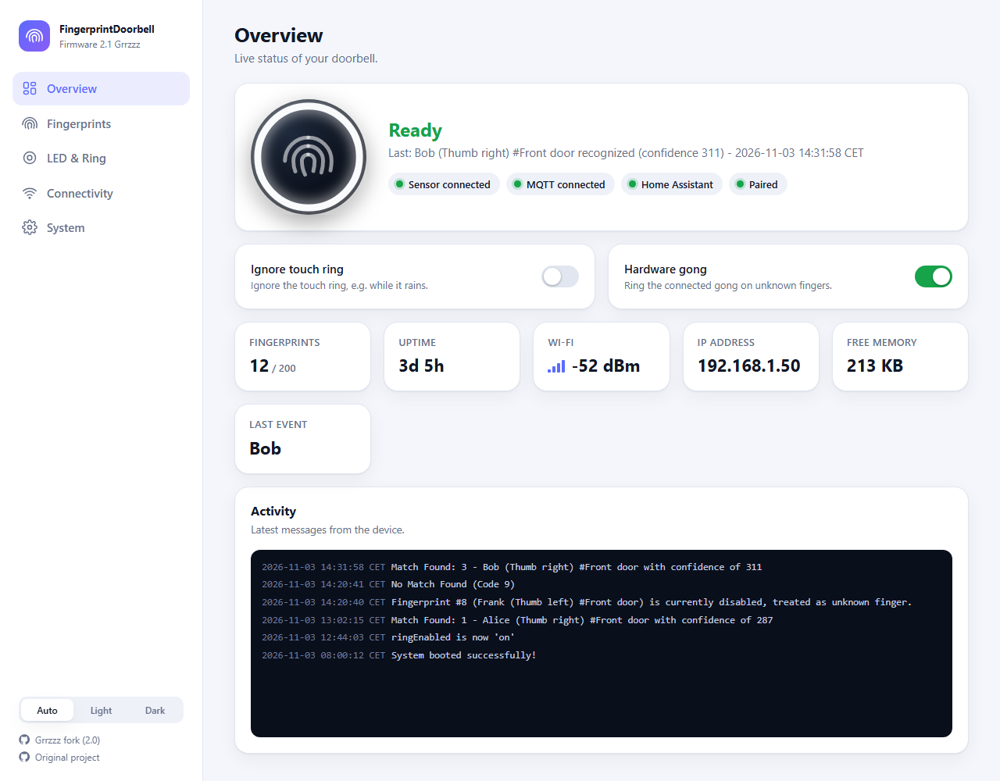
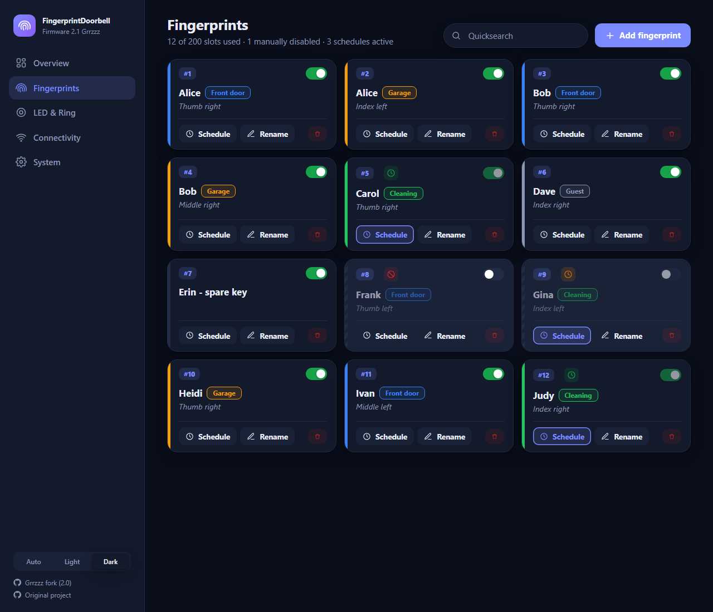
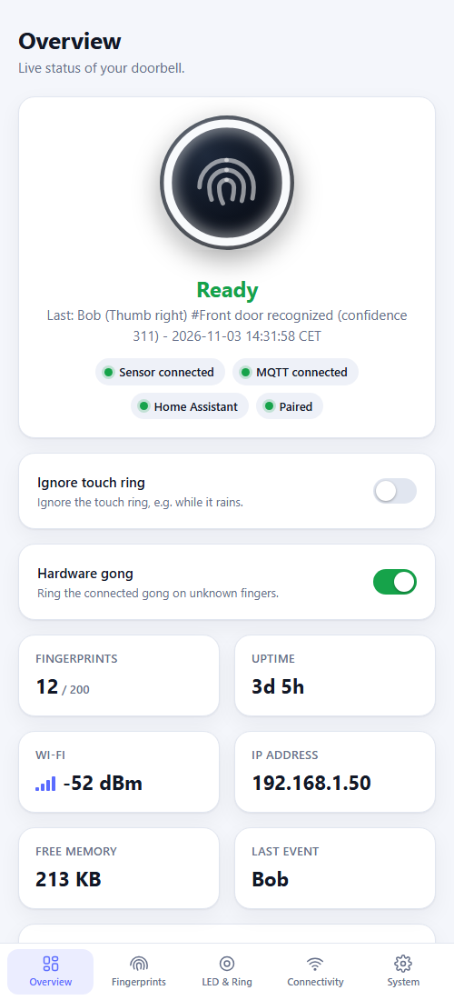
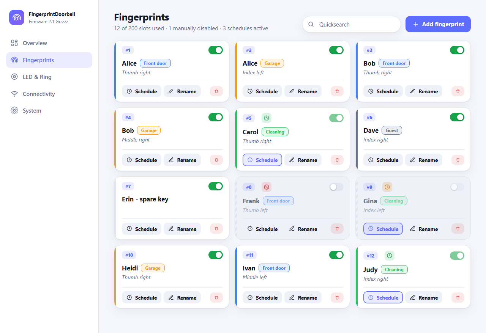
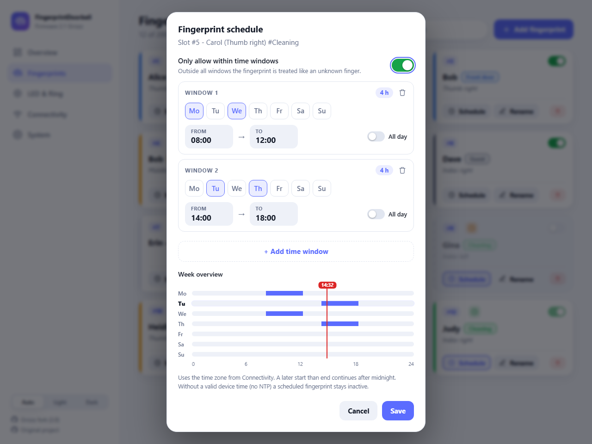
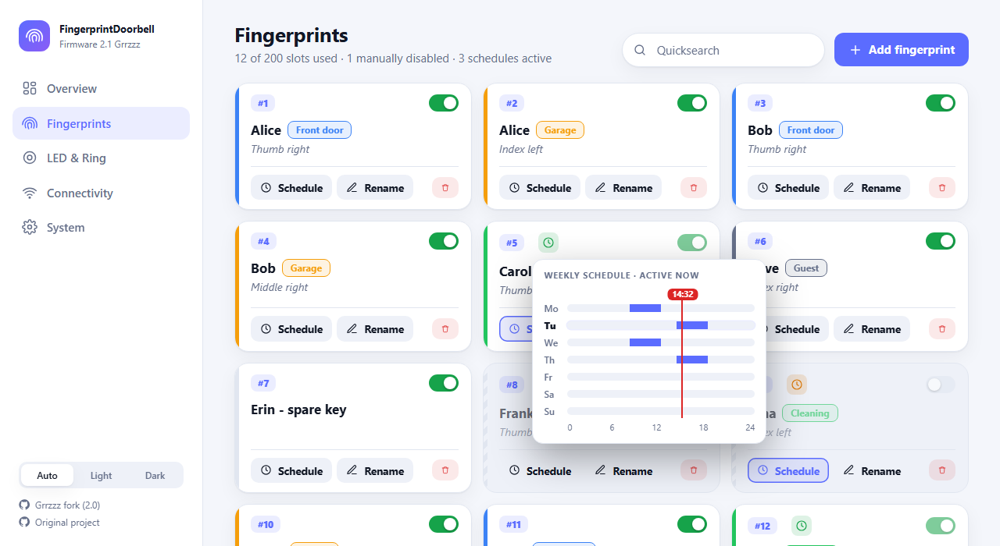
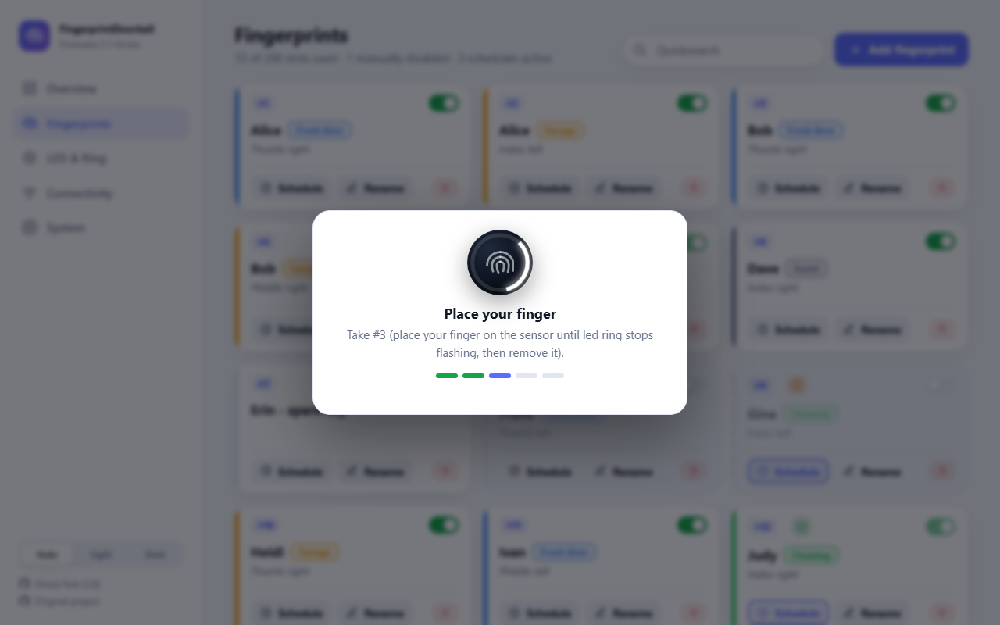
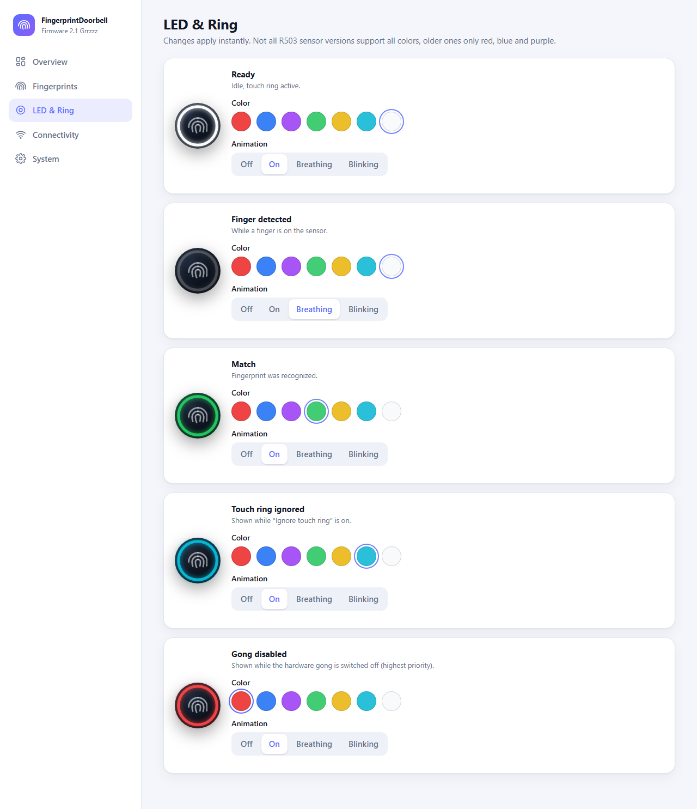
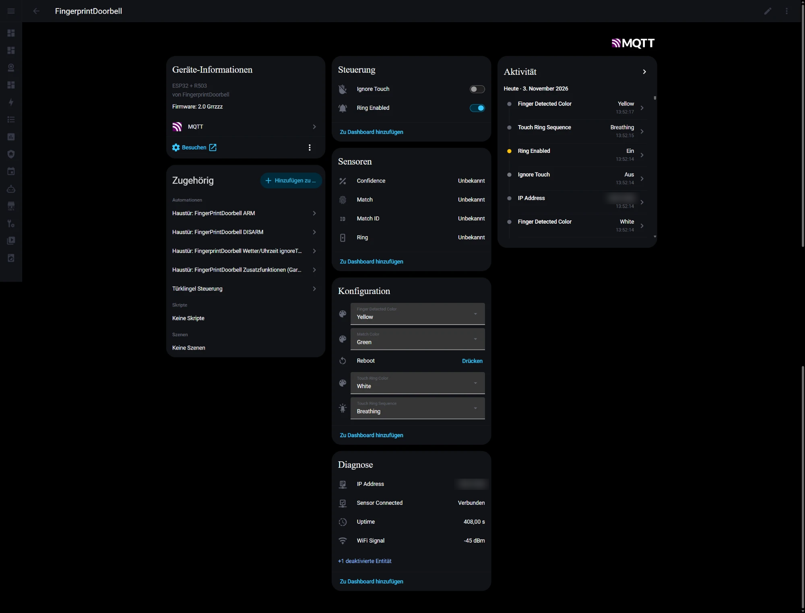
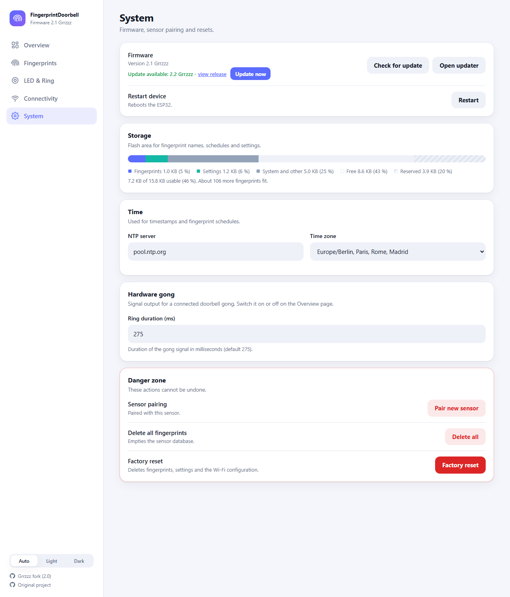

# FingerprintDoorbell 2.1 "Grrzzz"

A fingerprint reader that doubles as a doorbell: an **ESP32** and a **Grow R503** sensor recognize fingers, ring the bell for everybody else and tell your smart home about both. This is a fork of [frickelzeugs/FingerprintDoorbell](https://github.com/frickelzeugs/FingerprintDoorbell) with a completely new web interface, Home Assistant auto discovery, per-fingerprint schedules, configurable LED states and one-click updates.



- [What is new in this fork](#what-is-new-in-this-fork)
- [Web interface](#web-interface)
- [Fingerprints: names, schedules, on and off](#fingerprints-names-schedules-on-and-off)
- [LED ring](#led-ring)
- [Home Assistant](#home-assistant)
- [MQTT topics](#mqtt-topics)
- [System: updates, time and storage](#system-updates-time-and-storage)
- [JSON API](#json-api)
- [Hardware and wiring](#hardware-and-wiring)
- [First time installation](#first-time-installation)
- [Updating an existing device](#updating-an-existing-device)
- [Building from source](#building-from-source)
- [Credits](#credits)

## What is new in this fork

| | |
| --- | --- |
| **New web interface** | Single page app served by the ESP32, no internet needed, light and dark mode, works on phones. |
| **Home Assistant auto discovery** | One device with all entities, LED settings and a gong button included. |
| **Fingerprint schedules** | Switch fingerprints on and off, or let up to four weekly time windows per fingerprint decide. |
| **Disabled fingerprints are visible** | A switched off finger rings like an unknown finger and is reported as a "disabled match" to MQTT and Home Assistant. |
| **Configurable LED ring** | Color and animation for ready, finger detected, match, touch ring ignored and gong disabled. |
| **One-click update** | The device downloads firmware and web interface from the GitHub release itself. |
| **Storage meter** | Shows what the flash area for names, schedules and settings holds. |
| **Smaller firmware** | 181 KB saved by removing unused code, leaving room for the new features. |

## Web interface

The Overview page mirrors the real LED ring, shows the state of sensor, MQTT, Home Assistant and pairing, has quick switches for "Ignore touch ring" and the hardware gong and keeps a scrollable activity log. On small screens the navigation moves to the bottom, and the theme can be set to auto, light or dark in the sidebar.

| Dark mode | Phone |
| --- | --- |
|  |  |

## Fingerprints: names, schedules, on and off



Every fingerprint is a card with its memory slot, a switch, and buttons for the schedule, renaming and deleting. The quicksearch above the cards finds fingerprints by name, finger, action, slot (`#12`) or state (`disabled`, `inactive`, `scheduled`). The line below the title shows how many slots are used, how many fingerprints are switched off by hand and how many have a schedule.

### Naming: name, finger and action

Names are free text (up to 48 bytes). If a name follows the pattern

```
<name> (<finger>) #<action>
```

for example `Alice (Thumb right) #Front door`, the card shows the name in bold, the finger in italics and the action as a colored badge. The action also colors the stripe at the left edge of the card.

| Action | Color |
| --- | --- |
| `Haustür`, `Front door` | blue |
| `Garage` | orange |
| `Reinigung`, `Cleaning` | green |
| anything else | grey |

Names that do not match the pattern are shown as they are. This is only a display convention, the full name is what is published to MQTT.

### Switching fingerprints on and off

The switch on a card turns a fingerprint off, for example while somebody is on holiday. A fingerprint that is off behaves like an unknown finger: the bell rings, but no match is reported and nothing is opened. The log notes it ("Disabled fingerprint detected: #8 ...") and Home Assistant receives the [Disabled Match](#home-assistant) sensor so you can react to it.

### Schedules



The **Schedule** button opens the editor. A schedule consists of up to four time windows. Each window has its own weekdays, a start and an end time (or "All day"), and the week overview below shows when the fingerprint is active, with a red marker for the current time of the device. A window that ends before it starts continues after midnight and belongs to the day it starts on.

- With a schedule, **the schedule alone decides**. The switch on the card is then locked and only shows the current state.
- Without a valid device time (no NTP), a fingerprint with a schedule stays inactive. Time and time zone are configured under [System](#system-updates-time-and-storage).
- A clock icon at the top of a card shows the schedule state (green: active now, orange: inactive now, red crossed circle: switched off). Hovering it shows the week overview.

| Week overview on hover | Time picker |
| --- | --- |
|  |  |

### Enrolling a fingerprint

**Add fingerprint** suggests the first free slot, asks for a name and guides you through the scans. The sensor wants five placements; do not vary the position too much, otherwise the scans cannot be combined. Closing the dialog cancels the enrollment on the device.



## LED ring



Color and animation of five states can be changed at any time, the change is applied instantly and also published to Home Assistant.

| State | Default | When |
| --- | --- | --- |
| Ready | white, on | idle, touch ring active |
| Finger detected | white, breathing | a finger is on the sensor |
| Match | green, on | a fingerprint was recognized |
| Touch ring ignored | cyan, on | "Ignore touch ring" is switched on |
| Gong disabled | red, on | the hardware gong is switched off |

If several states apply the ring shows the one with the highest priority: **gong disabled** over **touch ring ignored** over **ready**. Colors 4 to 7 (green, yellow, cyan, white) need a newer R503 sensor, older ones can only show red, blue and purple. Fixed states of the original firmware stay as they were: red/on is an error, red/breathing is Wi-Fi configuration, purple while enrolling.

## Home Assistant

The device announces itself through MQTT auto discovery as **one device with all its entities**, including firmware version and a link to the web interface.



| Entity | Type | Description |
| --- | --- | --- |
| Ring | binary sensor | `on` when somebody rings (unknown finger) |
| Match, Confidence, Match ID | sensors | name, confidence and slot of the recognized finger |
| Disabled Match | sensor | name of a recognized finger that is switched off or outside its schedule. Attributes: `id`, `name`, `reason`, `confidence`, `time`. Triggers on every detection |
| Ignore Touch, Ring Enabled | switches | ignore the touch ring, enable the hardware gong |
| Ring Gong | button | rings the mechanical gong, even if the automatic gong is disabled |
| Reboot | button | restarts the device |
| LED selects (10) | selects | color and animation of the five LED states |
| IP Address, WiFi Signal, Uptime, Sensor Connected | diagnostic | refreshed every 60 s |
| Free Heap | diagnostic | free memory, disabled by default |

How it works:

- Configs are published retained to `<prefix>/<component>/fingerprintdoorbell_<mac>/<entity>/config`. The unique id is derived from the MAC address and survives renaming.
- All entities use the availability topic `<rootTopic>/connection` (`online`, `offline` as last will).
- Everything is republished when Home Assistant restarts. State topics are retained, so values are there right after (re)discovery.
- Discovery can be switched off (the entities are removed again) and the discovery prefix can be changed under **Connectivity**.

Typical automations use the Ring binary sensor for the bell, the Match sensor to open a door (react to the `#Garage` or `#Front door` part of the name) and the Disabled Match sensor for notifications.

## MQTT topics

Below the root topic (default `fingerprintDoorbell`, configurable). The broker can be entered as `host` or `host:port`.

| Topic | Direction | Values |
| --- | --- | --- |
| `ring` | publish | `on` on a ring event, then `off` |
| `matchId`, `matchName`, `matchConfidence` | publish | the recognized fingerprint, `-1` / empty when idle |
| `disabledMatchName`, `disabledMatchInfo` | publish | a recognized but switched off fingerprint; info is JSON (`id`, `name`, `reason`, `confidence`, `time`); not retained |
| `connection` | publish, retained | `online` / `offline` (last will) |
| `uptime`, `wifiRssi`, `ipAddress`, `freeHeap`, `sensorConnected` | publish, retained | device status |
| `ignoreTouchRing`, `ringEnabled` | publish retained and subscribe | `on` / `off`, also published when changed in the web interface |
| `touchRingColor`, `touchRingSequence`, `scanColor`, `scanSequence`, `matchColor`, `matchSequence`, `ignoreColor`, `ignoreSequence`, `gongOffColor`, `gongOffSequence` | publish retained | current LED settings (`Red`, `Blue`, `Purple`, `Green`, `Yellow`, `Cyan`, `White`; `Breathing`, `Flashing`, `On`, `Off`) |
| `<led setting>/set` | subscribe | change an LED setting |
| `gong` | subscribe | payload `press` rings the gong |
| `reboot` | subscribe | payload `press` restarts the device |

### What is "Ignore touch ring"?

The sensor reacts to a touch of the metal ring around it, which makes it very sensitive for visitors who just want to ring the bell. Rain drops can trigger the capacitive ring as well, and nobody wants the storm to ring the bell at 3 AM. Set `ignoreTouchRing` to `on` (for example from a rain sensor) to ignore the ring and only evaluate the sensor surface. The LED ring shows the state with the "touch ring ignored" color.

## System: updates, time and storage



- **Firmware**: shows the version and checks the latest release on GitHub (the browser asks GitHub, the device needs no internet access for that). If a newer release exists, **Update now** lets the device download and install it itself (see [Updating](#updating-an-existing-device)).
- **Storage**: stacked bar of the flash area that holds fingerprint names, schedules and settings (fingerprints, settings, system and other, free, reserved) with an estimate how many fingerprints still fit.
- **Time**: NTP server and time zone (default Europe/Berlin). Timestamps and schedules use it.
- **Hardware gong**: duration of the signal on the output pin (default 275 ms). The gong itself is switched on the Overview page.
- **Danger zone**: pairing a new sensor, deleting all fingerprints, factory reset.

Settings on the **System** and **Connectivity** pages share one save bar: when something changed it appears at the bottom with *Discard* and *Save*. Changes that need a restart (broker, NTP, time zone) say *Save & restart*, the gong duration applies immediately.

### Pairing

For security the ESP32 and the sensor are paired. If the sensor is replaced, the pairing is marked as broken and no match events are sent any more, but the doorbell function keeps working. If you replaced the sensor yourself, use **Pair new sensor**.

## JSON API

The web interface uses a small API that you can use from scripts. There is no authentication, run the device in a trusted network only.

| Endpoint | Description |
| --- | --- |
| `GET /api/status` | hostname, version, uptime, Wi-Fi, IP, memory, mode, sensor/MQTT/pairing state, switches, last event, device clock, update state, log |
| `GET /api/fingerprints` | fingerprints with name, switch, schedule windows and whether they are active right now |
| `GET /api/settings` | all settings (includes the MQTT password) |
| `GET /api/led?setting=<name>&value=<n>` | change an LED setting (colors 1-7: red, blue, purple, green, yellow, cyan, white; animation 1-4: breathing, flashing, on, off) |
| `GET /api/control?ignoreTouchRing=on\|off&ringEnabled=on\|off` | switch without restart |
| `GET /api/finger/policy?id=1&enabled=0&scheduled=1&w=31,480,720,0;96,0,0,1` | switch a fingerprint or set its schedule; `w` holds up to four windows `days,from,to,allDay` (days: bit 0 = Monday, times in minutes) |
| `GET /api/storage` | usage of the settings flash area |
| `GET /api/enroll/cancel` | cancel a running enrollment |
| `GET /api/selfupdate/start?tag=v2.1` | start the one-click update to a release of this fork |

## Hardware and wiring

You need

- a fingerprint reader **Grow R503** (e.g. [AliExpress](https://de.aliexpress.com/i/33053783539.html))
- an **ESP32** microcontroller. The mini version is nice because of its size ([example](https://de.aliexpress.com/item/1005001621844145.html)), any dealer you trust will do.

### Wiring


I would not solder the cables directly to the ESP32 but use a connector between ESP32 and sensor. Otherwise the cables must first be fed through the 25mm hole for the sensor and then soldered on, and replacing the sensor will be a pain. The original plug on the sensor is a 6-pin Micro JST SH 1.00mm, but any other 6-pin connector will do if you replace both sides.

Just as an inspiration:


The author of the original project made a small shield board for the ESP32 mini with a 6-pin Micro JST SH 1.00mm socket, a DC-DC step down converter and screw terminals for the power supply (24 V DC in his case). Sensor and ESP32 can then be replaced without a soldering iron.

**Caution:** do not forget to ground the sensor housing. Otherwise electrostatic charge can lead to unexpected restarts or even damage the ESP32.

## First time installation

### Flash the firmware

#### Method 1: browser flasher plus update (recommended)

The [FingerprintDoorbell Flasher](https://frickelzeugs.github.io/FingerprintDoorbell-flasher/) of the original project flashes the ESP32 from your browser (Chrome, Edge or Opera required). It installs the original firmware, this fork is compatible with it. Do the [Wi-Fi setup](#wi-fi-setup) below and then update to this fork over the air as described in [Updating](#updating-an-existing-device).

#### Method 2: precompiled binaries with esptool

Install Python and the flash tool:

```
pip install esptool
```

You need five files: `bootloader_dio_40m.bin`, `boot_app0.bin` and `partitions.bin` from [bootloader.zip](https://raw.githubusercontent.com/Grrzzz/FingerprintDoorbell/master/doc/bootloader.zip), and `firmware.bin` and `spiffs.bin` from the [latest release](https://github.com/Grrzzz/FingerprintDoorbell/releases/latest). Put them into one folder and run:

```
esptool.py --chip esp32 --baud 460800 --before default_reset --after hard_reset write_flash -z --flash_mode dio --flash_freq 40m --flash_size detect 0x1000 bootloader_dio_40m.bin 0x8000 partitions.bin 0xe000 boot_app0.bin 0x10000 firmware.bin 2686976 spiffs.bin
```

The LED ring should now breathe slowly red: the device waits for its Wi-Fi configuration.

#### Method 3: build and flash with PlatformIO

See [Building from source](#building-from-source).

### Wi-Fi setup

With no Wi-Fi configured (a fresh install) the device starts in configuration mode and the LED ring breathes red. It opens its own network **FingerprintDoorbell-Config**, password `12345678`. Connect with a PC or phone, a captive portal should open the setup page. If not, browse to `http://192.168.4.1`.


Enter your Wi-Fi and click **Save and restart**. The LED ring flashes blue while booting and then shows the ready color (white by default) once the connection works. The web interface is then reachable at `http://fingerprintdoorbell` (if you kept the default hostname). Once Wi-Fi is configured the device never enters configuration mode again, even without Wi-Fi. To get it back, hold a finger on the sensor for at least 10 seconds while powering on, or use the factory reset.

After that open **Connectivity** to enter your MQTT broker and start enrolling fingerprints.

## Updating an existing device

**From 2.1 on: one click.** When the Firmware card on the System page reports a newer release, click **Update now**. The device checks both release files, installs the web interface, installs the firmware and restarts; a progress bar shows the steps. If something fails, the update stops with an error message and you can simply start it again.

**From older versions, or manually (over the air):**

1. Download `firmware.bin` and `spiffs.bin` from the [release](https://github.com/Grrzzz/FingerprintDoorbell/releases/latest).
2. Open `http://<device>/update` (System, *Open updater*).
3. Select **Firmware**, upload `firmware.bin` and wait for the restart.
4. The page may look broken for a moment, the new firmware still has the old web interface. Open `/update` again, select **Filesystem**, upload `spiffs.bin`.
5. Reload the page with Ctrl+F5.

Your Wi-Fi, MQTT settings, fingerprints and sensor pairing are kept, also when coming from the official version.

> **Note on 2.1:** names and schedules of the fingerprints are moved to a more compact storage format the first time 2.1 starts. This is automatic and keeps all data. Older firmware versions cannot read the new format, so after going back to 2.0.x or the official release the fingerprints are still on the sensor but their names are missing. Update again to get them back.

## Building from source

Install [Visual Studio Code with the PlatformIO extension](https://platformio.org/platformio-ide), clone the repository and open it. In the PlatformIO tasks of `esp32doit-devkit-v1` choose **Build** (creates `firmware.bin`) and **Build Filesystem Image** (creates `spiffs.bin` with the web interface), then **Upload** and **Upload Filesystem Image**.

Two notes:

- The registry no longer resolves `me-no-dev/ESP Async WebServer`. Install the libraries from `lib_deps` manually into `lib/`.
- The firmware only fits next to the one-click update if the library does not pull in `std::regex`. Apply [`lib_patches/ESPAsyncWebServer-no-regex.patch`](lib_patches/ESPAsyncWebServer-no-regex.patch) to the library (`git apply` in `lib/ESP Async WebServer`). It makes the regex support of URL handlers optional (not used by this firmware) and saves about 180 KB.

## Credits

This project is based on [FingerprintDoorbell](https://github.com/frickelzeugs/FingerprintDoorbell) by frickelzeugs. Thanks to TheMaskedDeveloper for the idea and the R503 color handling of [PR #26](https://github.com/frickelzeugs/FingerprintDoorbell/pull/26), which was merged into this fork. The web interface of the official firmware uses [AsyncElegantOTA](https://github.com/ayushsharma82/AsyncElegantOTA) for the manual updater. Screenshots in this README were created from a virtual device with made-up data.
