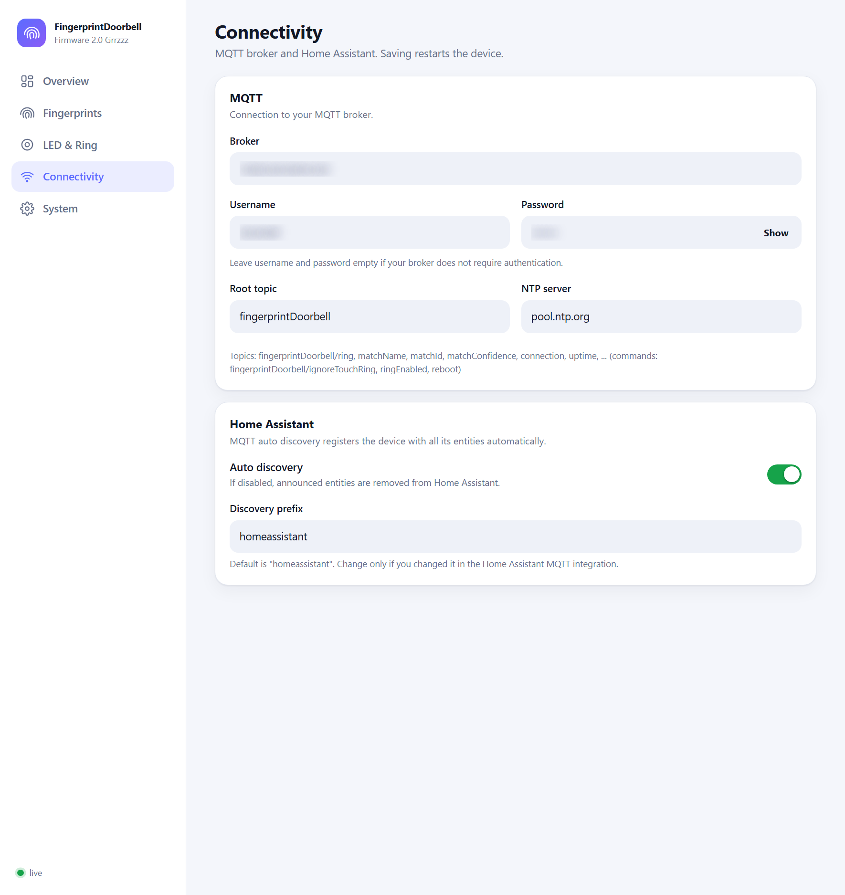

# FingerprintDoorbell

## What is FingerprintDoorbell?
It's more or less a doorbell with the ability to scan finger prints or a fingerprint reader with the ability to act as doorbell, depending on your perspective ;-). But lets speak some images:


> **About this fork**
> This fork of [frickelzeugs/FingerprintDoorbell](https://github.com/frickelzeugs/FingerprintDoorbell) is version **2.0 "Grrzzz"**. It adds a completely redesigned web interface, **Home Assistant MQTT auto discovery**, configurable LED colors and animations, a small JSON API and a few quality-of-life improvements. Everything is documented below, with screenshots.


## What's new in this fork

- [New web interface](#1-new-web-interface)
- [Home Assistant MQTT auto discovery](#2-home-assistant-mqtt-auto-discovery)
- [LED ring: configurable colors, animations and a clear priority](#3-led-ring-configurable-colors-animations-and-priorities)
- [MQTT: host:port, availability, status topics, remote reboot](#4-mqtt-improvements)
- [JSON API](#5-json-api)
- [Upgrade notes](#upgrade-notes)

### 1. New web interface
The old Bootstrap form pages (which needed an internet connection for their stylesheet) were replaced by a small single page application served from the ESP32 itself. It has no external dependencies, follows the light/dark mode of your device and works on phones.

| | |
| --- | --- |
| **Overview** shows the live state of the doorbell: a sensor disc that mirrors the real LED ring (color and animation), status chips (sensor, MQTT, Home Assistant, pairing), quick switches for "Ignore touch ring" and "Hardware gong", uptime, Wi-Fi signal, IP address, free memory, the last event and a scrollable activity log. |  |
| **Fingerprints** are shown as cards with rename and delete actions. |  |
| **Add fingerprint** suggests the first free memory slot and shows the progress of the enrollment live. |  |
| **LED & Ring**: pick colors with a click, changes are applied instantly (no restart) and are also published to Home Assistant. The hardware gong (enable/disable and ring duration) is configured here as well. |  |
| **Connectivity**: MQTT broker (`host` or `host:port`), credentials, root topic, NTP server and the Home Assistant discovery settings. A save bar appears when something was changed; saving restarts the device and the page reconnects automatically. |  |
| **System**: firmware updater, sensor pairing, restart, delete all fingerprints and factory reset (all destructive actions ask for confirmation). |  |
| **Responsive**: on small screens the navigation moves to the bottom. |  |

Screenshots show the real device; fingerprint names, IP addresses and MQTT credentials are blurred or replaced by placeholders.

### 2. Home Assistant MQTT auto discovery
FingerprintDoorbell now announces itself to Home Assistant. No more hand written MQTT YAML: the device shows up as **one device** with all of its entities, including firmware version and a link to the web interface.


| Entity | Type | MQTT topic (below the root topic) | Description |
| --- | --- | --- | --- |
| Ring | binary sensor | `ring` | `on` when somebody rings (unknown finger) |
| Match | sensor | `matchName` | name of the recognized finger |
| Confidence | sensor | `matchConfidence` | recognition confidence |
| Match ID | sensor | `matchId` | memory slot of the recognized finger |
| Ignore Touch | switch | `ignoreTouchRing` | ignore the touch ring (e.g. in rain) |
| Ring Enabled | switch | `ringEnabled` | enable/disable the hardware gong |
| Touch Ring Color / Touch Ring Sequence | select | `touchRingColor`, `touchRingSequence` (+ `/set`) | LED color and animation when ready |
| Finger Detected Color | select | `scanColor` (+ `/set`) | LED color while a finger is on the sensor |
| Match Color | select | `matchColor` (+ `/set`) | LED color on a match |
| Reboot | button | `reboot` (payload `press`) | restarts the device |
| IP Address, WiFi Signal, Uptime | diagnostic sensors | `ipAddress`, `wifiRssi`, `uptime` | updated every 60 s |
| Free Heap | diagnostic sensor (disabled by default) | `freeHeap` | free memory |
| Sensor Connected | diagnostic binary sensor | `sensorConnected` | fingerprint sensor reachable |

How it works:
- Discovery configs are published retained to `<prefix>/<component>/fingerprintdoorbell_<mac>/<entity>/config`. The unique id is derived from the MAC address and therefore stays the same if you rename the device.
- All entities use the availability topic `<rootTopic>/connection` (`online` / `offline`). `offline` is the MQTT last will, so Home Assistant marks everything as unavailable when the device disappears.
- The device republishes everything when Home Assistant restarts (it listens to `<prefix>/status`).
- State topics are retained, so entities have a value right after (re)discovery.
- Settings (Connectivity page): switch discovery on/off and set the discovery prefix (default `homeassistant`). Disabling discovery removes the entities from Home Assistant again.
- The three LED selects change the same settings as the web interface, they are saved on the device and applied immediately.

### 3. LED ring: configurable colors, animations and priorities
Colors and animations are no longer hard coded. The idea and the R503 color handling come from [PR #26](https://github.com/frickelzeugs/FingerprintDoorbell/pull/26) by TheMaskedDeveloper; it was merged here, extended with live updates, Home Assistant entities and an input validation, and an unsafe pointer in the MQTT `host:port` parsing was fixed.

| State | Default | Configurable |
| --- | --- | --- |
| Ready (touch ring active) | white, on | color and animation (off / on / breathing / blinking) |
| Finger detected | white, breathing | color |
| Match | green | color |
| Touch ring ignored | cyan, on | no |
| Hardware gong disabled | red, on | no |

If several states apply, the ring shows the one with the highest priority: **gong disabled** (red, on) > **ignore touch ring** (cyan, on) > **configured colors**. The dashboard preview follows the same rules. Colors 4-7 (green, yellow, cyan, white) are only supported by newer versions of the R503 sensor, older ones can only show red, blue and purple.

### 4. MQTT improvements
- The broker can be entered as `host` or `host:port` (default port 1883).
- New topics (below the root topic):

| Topic | Direction | Values |
| --- | --- | --- |
| `connection` | publish, retained | `online` / `offline` (last will) |
| `uptime`, `wifiRssi`, `ipAddress`, `freeHeap`, `sensorConnected` | publish, retained | device status, refreshed every 60 s |
| `touchRingColor`, `touchRingSequence`, `scanColor`, `matchColor` | publish, retained | current LED settings (`Red`, `Blue`, `Purple`, `Green`, `Yellow`, `Cyan`, `White`; sequences `Breathing`, `Flashing`, `On`, `Off`) |
| `<setting>/set`, e.g. `touchRingColor/set` | subscribe | change an LED setting |
| `ringEnabled` | publish retained / subscribe | `on` / `off`, also published when changed in the web interface |
| `ignoreTouchRing` | publish retained / subscribe | `on` / `off`, also published when changed in the web interface |
| `reboot` | subscribe | payload `press` restarts the device |

- The **last will** of the MQTT connection is now `<rootTopic>/connection` = `offline` (retained). Before, it was a text message on `lastLogMessage`.
- The default ring duration of the hardware gong is now **275 ms** (already stored values are kept).

### 5. JSON API
The web interface uses a small read/write JSON API that you can also use from scripts:

| Endpoint | Description |
| --- | --- |
| `GET /api/status` | hostname, version, uptime, Wi-Fi, IP, memory, mode, sensor/MQTT/pairing state, switches, last event and the log |
| `GET /api/fingerprints` | `[{"id":1,"name":"..."}, ...]` |
| `GET /api/settings` | all settings (including the MQTT password, like the old settings page) |
| `GET /api/led?setting=<touchRingColor\|touchRingSequence\|scanColor\|matchColor>&value=<n>` | change an LED setting instantly (colors 1-7: red, blue, purple, green, yellow, cyan, white; sequence 1-4: breathing, flashing, on, off) |
| `GET /api/control?ignoreTouchRing=on\|off&ringEnabled=on\|off` | switch without restart |

There is no authentication, as before: operate the device in a trusted network only.

### Upgrade notes
- **Flash both images.** The web interface lives in the filesystem. When updating over the air (`/update`) upload `firmware.bin` *and* `spiffs.bin` (Filesystem). The old `index.html`, `settings.html` and `bootstrap.min.css` are gone, the new files are `app.html`, `app.js` and `style.css`.
- Your settings (Wi-Fi, MQTT, fingerprints, pairing) are stored separately and survive the update.
- **Home Assistant:** if you used hand written MQTT entities before, remove them after switching to discovery, otherwise you have every entity twice. The ring is now a `binary_sensor` (it was a `sensor` with the states `on`/`off`). Automations that triggered on the MQTT topic `<root>/ring` keep working, but a state trigger on the new `binary_sensor.<name>_ring` is the cleaner way.
- If the build reports that `me-no-dev/ESP Async WebServer` cannot be found in the PlatformIO registry, install the libraries from `lib_deps` manually into `lib/` (the firmware was built that way).

---

## How does it work?
If you put your finger on the sensor the system looks for a matching fingerprint. If it doesn't find one, it rings the bell (MQTT message is published and an GPIO pin is set to high). If a match was found, the matching finger ID together with a name and confidence will be published as MQTT messagage. In combination with a home automation solution (like OpenHAB, ioBroker, Home Assistant...) you can then trigger your door opener or smart lock. You can also define actions depending on the finger that was detected, like left thumb opens front door, right thumb opens garage, middle finger...

  

## What do I need?
- fingerprint reader Grow R503 (available at https://de.aliexpress.com/i/33053783539.html)
- an ESP32 microcontroller (I would prefer the mini-version, because of it's compact size, e.g. available here https://de.aliexpress.com/item/1005001621844145.html or from any other dealer of your trust)

# How to build the hardware
## Wiring


I would not solder the cables directly to the ESP32 but recommend using a connector between ESP32 and Sensor. Otherwise, the cables must first be fed through the 25mm hole for the sensor and then soldered on. Replacing the Sensor will be a pain then. The original plug used on the sensor is a 6-pin Micro JST SH 1.00mm but it'll be fine to use any other 6-pin connector that you have on hand if you replace both sides.

Just as an inpiration:


I made a small shield board for the ESP32 mini that contains a 6 pin Micro JST SH 1.00mm socket, a DC-DC step down converter and some screw terminals for the power supply (in my case 24V DC). So I'm now able to easily replace the sensor or ESP32 without touching my soldering iron.

Caution: Please do not forget to ground the sensor housing. Otherwise it can lead to unexpected restarts or even damages the ESP32 if you are electrostatically charged. I had occasional restarts when touching the sensor after I was electrostatically charged from the floor mats in the car.

# Flashing the firmware
## Method 1 (recommended!):
This is the absolute preferred method over method 2, which was the standard method in the past. Thanks to the great work of the [ESP Web Tools](https://esphome.github.io/esp-web-tools/) project, flashing your ESP is now as easy as pie. All you need to do is connect your ESP32 module via USB and simply flash FingerprintDoorbell via your browser (Chrome, Edge or Opera required):

### --> [FingerprintDoorbell Flasher](https://frickelzeugs.github.io/FingerprintDoorbell-flasher/)


## Method 2: use precompiled binaries
To flash the ESP32 with the precompiled binaries you can use the python based esptool from espressif. You'll need a running Python environment on your system, so get Python first here if you don't already have it: [Python download](https://www.python.org/downloads/)

After python is available run the following command in your shell/cmd to install esptool:
```
pip install esptool
```
If there is a `command not found: pip` error but you have installed Python try to use pip3 insted of pip.
```
pip3 install esptool
```


Now esptool should be available in your shell/cmd. Check it by running:
```
esptool.py
```

Now that esptool.py is available you can continue to flash the firmware. To start you will need 5 files:

- bootloader_dio_40m.bin
- boot_app0.bin
- partitions.bin

download [here](https://raw.githubusercontent.com/frickelzeugs/FingerprintDoorbell/master/doc/bootloader.zip)

- firmware.bin
- spiffs.bin

contained in the [Release packages](https://github.com/frickelzeugs/FingerprintDoorbell/releases)

### Flashing
Copy all 5 files in a local folder, open your command line/shell, navigate to this folder and execute:

```
esptool.py --chip esp32 --baud 460800 --before default_reset --after hard_reset write_flash -z --flash_mode dio --flash_freq 40m --flash_size detect 0x1000 bootloader_dio_40m.bin 0x8000 partitions.bin 0xe000 boot_app0.bin 0x10000 firmware.bin 2686976 spiffs.bin
```

If everything has worked your output should look something like this:

```
esptool.py v3.2
Found 2 serial ports
Serial port COM4
Connecting....
Chip is ESP32-D0WDQ6 (revision 1)
Features: WiFi, BT, Dual Core, 240MHz, VRef calibration in efuse, Coding Scheme None
Crystal is 40MHz
MAC: 9c:9c:1f:c7:ac:a0
Uploading stub...
Running stub...
Stub running...
Changing baud rate to 460800
Changed.
Configuring flash size...
Auto-detected Flash size: 4MB
Flash will be erased from 0x00001000 to 0x00005fff...
Flash will be erased from 0x00008000 to 0x00008fff...
Flash will be erased from 0x0000e000 to 0x0000ffff...
Flash will be erased from 0x00010000 to 0x00121fff...
Flash will be erased from 0x00290000 to 0x003fffff...
Compressed 17104 bytes to 11191...
Wrote 17104 bytes (11191 compressed) at 0x00001000 in 0.6 seconds (effective 225.1 kbit/s)...
Hash of data verified.
Compressed 3072 bytes to 128...
Wrote 3072 bytes (128 compressed) at 0x00008000 in 0.1 seconds (effective 300.7 kbit/s)...
Hash of data verified.
Compressed 8192 bytes to 47...
Wrote 8192 bytes (47 compressed) at 0x0000e000 in 0.1 seconds (effective 463.9 kbit/s)...
Hash of data verified.
Compressed 1119504 bytes to 666873...
Wrote 1119504 bytes (666873 compressed) at 0x00010000 in 16.1 seconds (effective 555.0 kbit/s)...
Hash of data verified.
Compressed 1507328 bytes to 36014...
Wrote 1507328 bytes (36014 compressed) at 0x00290000 in 7.5 seconds (effective 1599.3 kbit/s)...
Hash of data verified.

Leaving...
Hard resetting via RTS pin...
```

Your device should now boot up and the LED ring should start flashing slowly red ("breathing") to signal that it's currently in WiFi Config mode. Proceed with the configuration of the device.

## Method 3: build and flash with Visual Studio Code and PlattformIO
If you want to build the firmware on your own (e.g. if you want to modify the code or you don't trust binaries) please follow the instructions below. I don't want to go into details here and assume that you already have experience with IDEs or using Git repos:
* Download and install [Visual Studio Code and PlattformIO Extension](https://platformio.org/platformio-ide).
* Install [Git](https://git-scm.com/downloads) if you don't have already
* Clone this GitHub repo and open the project workspace in VS Code (you can do this in one step from within VS Code)
* Open the PlatformIO extension from the left sided toolbar and from the "Project Tasks" tree choose
  * esp32doit-devkit-v1 -> General -> Build (creates firmware.bin)
  * esp32doit-devkit-v1 -> Platform -> Build Filesystem Image (creates spiffs.bin containing HTML and CSS files)
* if the build finishes successfully you can start uploading to your ESP32 by using the following tasks
  * esp32doit-devkit-v1 -> General -> Upload
  * esp32doit-devkit-v1 -> Platform -> Upload Filesystem Image

# Configuration
## WiFi Connection
If no WiFi settings are configured (e.g. on a fresh install) the device will automatically boot into WiFi configuration mode (LED ring is breathing red). Once your WiFi connection is configured the device will never enter WiFi config mode again, even if the WiFi is not available or it cannot connect because of errors. If you later want to enter WiFi configuration mode again you have to press and hold your finger at least 10s on the sensor while powering on the device (or trigger a reboot through WebUI). 

When in WiFi config mode FingerprintDoorbell will act as an AccessPoint an creates it's own Network with the Name "FingerprintDoorbell-Config". Connect to this network with your PC/Mobile and Password "12345678". You should then get a "captive portal" notification, which you should bring you to the browser with the WiFi config already open. If the captive portal thing does not work please open a browser manually and visit "http://192.168.4.1".


Enter your settings and click "Save and restart" to bring the device back to normal operation mode. If everything had worked the LED ring should first flash blue while bootup and starts breathing blue if connection to your WiFi is running. When connected to your WiFi the WebUI of Fingerprintdoorbell should be available under http://fingerprintdoorbell (if you used the default hostname in WiFi configuration). Now you can start enrolling ("teaching") your fingerprints.

## Managing fingerprints
The sensor has the capacity for storing up to 200 fingerprints. Theses memory slots are used as ID together with a name to increase human readability. To enroll new fingerprints enter a ID and name (optional) in the "Add/Replace fingerprint" section and click "Start enrollment". Now the system asks you to place and lift your finger to the sensor for 5 times. The 5 passes of scanning helps the sensor to improve its recognition rate. Don't try to vary your placing/position too much, because the enrollment process may fail if the 5 preceeding scans differ too much from each other and cannot be combined to one fingerprint template.


If enrollment has completed successfull you can now test if your fingerprint matches.

## Configure MQTT connection
Matching fingerprints (and also ring events) are published as messages to your MQTT broker at certain topics. For this you will have to configure your MQTT Broker settings in FingerprintDoorbell. If your broker does not need authentification by username and password just leave this fields empty. You can also specify a custom root topic under which FingerprintDoorbell publishes its messages or leave the default "fingerprintDoorbell" if you're fine with that.


| MQTT Topic                           | Action    | Values | 
| ------------------------------------ | --------- | -------- |
| fingerprintDoorbell/ring             | publish   | "off" by default, on a ring event switching to "on" for 1s |
| fingerprintDoorbell/matchId          | publish   | "-1" by default, if a match was found the value holds the matching id (e.g. "27") for 3s |
| fingerprintDoorbell/matchName        | publish   | "" by default, if a match was found the value holds the matching name for 3s |
| fingerprintDoorbell/matchConfidence  | publish   | "" by default, if a match was found the value holds the conficence (number between "1" and "400", 1=low, 400=very high) for 3s |
| fingerprintDoorbell/ignoreTouchRing  | subscribe | read by FingerprintDoorbell and enables/disables the touch ring (see FAQ below for details) |

## Advanced Actions
### Firmware Update
If you've managed to walk the bumpy path of flashing the firmware on the ESP32 for the first time, dont't worry: every further firmware update will be a piece of cake. FingerprintDoorbell is using the really cool Library [AsyncElegantOTA](https://github.com/ayushsharma82/AsyncElegantOTA) to make this as handy as possible. You don't even have to pull the microcontroller out of the wall and connect it to your computer, because the "OTA" in "AsyncElegantOTA" is for "Over-the-air" updates. All you need to do is to browse to the settings page of the WebUI and hit "Firmware update". In the following Dialog you have to upload 2 files

- firmware.bin for the "Firmware" radio button
- spiffs.bin for the "Filesystem" radio button

Done. Reboot your system to get the new firmware live.

### Pairing a new Sensor
For security reasons the ESP32 and Sensor will be coupled together, so if the sensor is replaced (e.g. an attackers connects his own sensor to the ESP32 with his fingerprints on it) this will be detected. In this case the pairing will be marked as broken and no further match events are sent by MQTT from now on (even if you connect the old sensor again). But keep calm, the doorbell function will still continue to work and ring events are sent by MQTT so you don't miss your long awaited package delivery. You'll see an error message in the log window that requests you to renew the pairing. If the sensor replacement was done by yourself or no attack took place please choose the option "Pairing a new Sensor" to pair the sensor with the ESP32.

### Factory Reset
As the name already says this will delete all your settings and fingerprints from the device. You'll have a blank device in WiFi Config mode when choosing this option. Be careful!

# FAQ
## What does the different colors/blinking styles of the LED ring mean?
In this fork the colors of the ready, finger-detected and match states are configurable and have different defaults, see [LED ring](#3-led-ring-configurable-colors-animations-and-priorities). The table below shows the original behavior of upstream.

|LED ring color| sequence | Meaning | 
| -------- | -------- | -------- |
| red | permanent | System is in error state |
| red | breathing | System in WiFi config mode |
| red | flashing  | Finger on sensor detected (no match found yet) |
| blue | permanent | System ready (touch ring ignored) |
| blue | breathing | System ready (touch ring active) |
| blue | flashing | System startup (not ready yet) |
| purple | solid | Fingerprint match found or when in enrollment mode this means pass is finished, lift your finger |
| purple | flashing | Enrollment active (waiting for finger) |

## What is the MQTT topic "fingerprintDoorbell/ignoreTouchRing" for and how to use it?
If your sensor is mounted in a dry environment and cannot be hit by rain you can skip this section. Otherwise please read further. The sensor consists mainly of two parts: the black sensor surface and a metal ring divided by the led ring around the sensor surface. The sensor surface will only recognize a finger touch if the larger part of the finger was on the sensor and not only a small tip. Also only short touches are not recognizes, because no image could be captured in this short timespan. Because a visitor who just wants to ring the bell doesn't pay particular attention to putting his finger completely on the sensor, I do not only evaluate the image sensor itself, but also consider the finger detection signal (pin 5) the sensor is providing. This signal is already triggered if you slightly touch the sensor and even if you only touch the metal ring and not yet the sensor surface. 

This ring is a capacitive touch sensor that works similar to the touch display of your smartphone. And if you may know touch displays and rain drops are not best friends, because they can lead to false inputs. This will usually be a problem if your sensor is mounted in a place exposed to rain and even if it's mounted under the roof overhang it may be hit by horizontal rain during a storm and causing false ring events. And believe me: your wife will not be happy if the storm rings on your door at 3 AM ;-)

So after this experience I could have added an option to disable this ring permanent in the settings but I decided to go another way and make this option conditional. Why? Because in >95% of the cases I really want this high sensitivity of the sensor, just not on stormy and rainy days. Fortunately I already had the current weather conditions available in my smart home via a rain sensor. So I added the MQTT topic "fingerprintDoorbell/ignoreTouchRing" which can be set to "on" or "off". In my case OpenHAB sets this value to "on" when it's raining and wind speed is over a certain level. Since then I have had no more problems with disturbing the peace at night.
